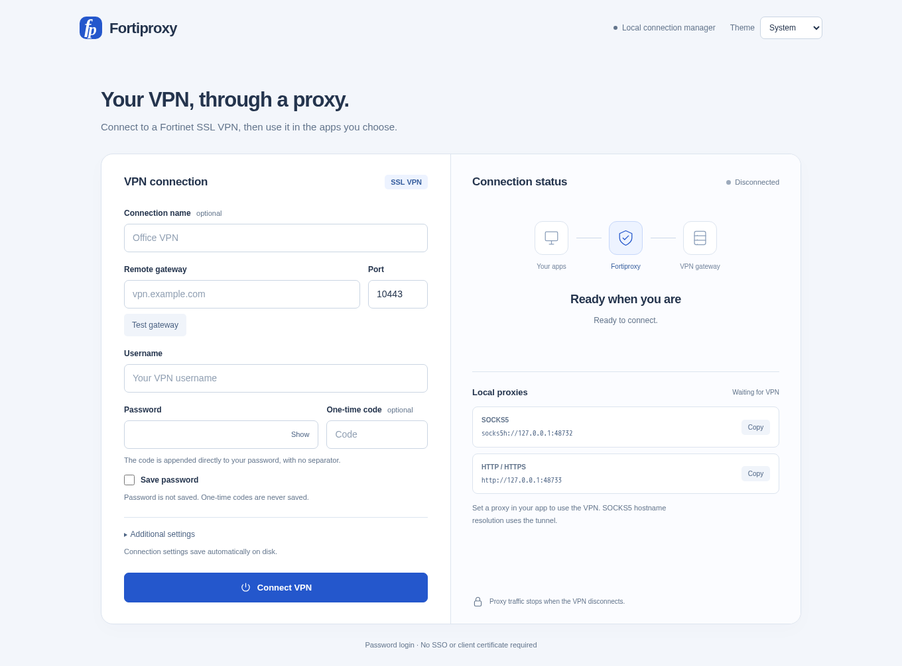

# Fortiproxy — Fortinet VPN in Docker

Run a Fortinet VPN connection inside a Docker container and use it from
individual apps through SOCKS5 or HTTP proxies. VPN traffic, DNS, and routing
stay inside the container, leaving your host’s network settings unchanged.



## Quick start

Install Docker Desktop or a Linux Docker engine with Compose, then download the
Compose file and start the published image. No checkout or local build is needed:

```sh
mkdir -p fortiproxy
cd fortiproxy
curl -fL https://raw.githubusercontent.com/mkay1375/fortiproxy/main/compose.yaml -o compose.yaml
docker compose pull
docker compose up -d
```

Already cloned the repo? Run the last two commands from its root.
The image, `ghcr.io/mkay1375/fortiproxy:latest`, supports Linux AMD64 and ARM64,
including Apple Silicon through Docker Desktop. It becomes available after the
first successful publishing workflow and after the GHCR package is made public.

Open **http://localhost:48731**, enter your gateway, port, username and password,
then select **Connect**. Custom ports such as `10443` are supported.

| Service | Local address |
| --- | --- |
| Web panel | `127.0.0.1:48731` |
| SOCKS5 | `127.0.0.1:48732` |
| HTTP / HTTPS CONNECT | `127.0.0.1:48733` |

- **Disconnect** stops the tunnel and blocks proxy egress. Closing the browser leaves the VPN running.
- Stopping/recreating the container or losing the tunnel ends the connection. Container restarts do not reconnect automatically.
- **Test gateway** checks TCP access from the container with a five-second deadline. It sends no credentials and does not validate TLS or VPN login.

### Use a proxy

After connecting, configure your app with an address above, or try:

```sh
curl --proxy socks5h://127.0.0.1:48732 https://example.com
curl --proxy http://127.0.0.1:48733 https://example.com
```

Use `socks5h` for DNS resolution inside the container. Apps resolving names on the
Mac before contacting SOCKS may use the Mac's existing DNS. HTTP CONNECT permits
ports 443 and 563; ordinary HTTP is also supported. Proxies carry TCP, not general
UDP traffic. Internet access depends on the VPN gateway; corporate gateways may
allow only private destinations.

### Update, stop or pin a version

Run these commands in the Compose folder:

| Action | Command |
| --- | --- |
| Update (disconnects the active VPN by recreating the container) | `docker compose pull` then `docker compose up -d` |
| Stop; keep saved profiles | `docker compose down` |
| Stop; delete saved profiles and passwords | `docker compose down -v` |
| Check health | `docker compose ps` |

To pin a published version, create `.env` beside `compose.yaml`:

```dotenv
FORTIPROXY_IMAGE=ghcr.io/mkay1375/fortiproxy:v1.0.0
```

Replace `v1.0.0` with an existing release tag; remove the override to use `latest`.

## Connection settings and security

### Supported connections

**SSL VPN** with password authentication, optional realm, optional one-time code
and optional SHA-256 certificate fingerprint. Browser SSO/SAML, IPsec and client
certificates are unsupported. A configuration screenshot cannot establish client
compatibility: server policies, MFA and endpoint checks may affect login.

The one-time code field is beside Password. By default, the code is appended to
the password without a separator; **Additional settings** also offers separate
gateway challenge mode.

### Saved settings and credentials

Settings save as you edit and reload with the UI: connection name, gateway, port,
username, realm, certificate settings and one-time code format.

- **Save password** is off by default. Enabling it stores the base password **unencrypted** in the private profile file. One-time codes and combined password+code values are never stored.
- After reload, **Saved password** indicates a stored secret; the profile API never returns it. Enter only a fresh one-time code to connect.
- Unchecking **Save password** removes the stored password. Changing gateway, port, username or realm invalidates it unless you explicitly enter a new password for that connection.

The mode-0600 `/data/profile.json` lives in Compose's `profile-data` named volume
and survives restarts and recreation. Local Python previews use
`data/profile.json` (or `FORTIPROXY_DATA`), excluded from Git.

Each connection uses a mode-0600 openfortivpn configuration under `/run` (a
Compose tmpfs), removed once connected, on failure or on disconnect. Credentials
stay in process memory while needed and are never logged or returned by the
status API. Re-enter unsaved credentials for the next connection.

### Certificates

Validation is **on by default**: normal CA/hostname checks apply, or you can supply
a SHA-256 fingerprint verified with your administrator. Leading/trailing spaces
and control characters are rejected because openfortivpn's parser would alter them.

**Additional settings → Ignore certificate validation** accepts the gateway's
current certificate without verifying its identity. This explicit opt-out is saved
only when selected; encryption and TLS 1.2+ remain enabled.

For each opt-out attempt, the backend fetches a fresh certificate digest without sending
credentials and passes it to openfortivpn. It neither saves the digest nor changes
macOS trust settings. A certificate change between probing and negotiation can
still fail the connection. This does not use openfortivpn's `--insecure-ssl`, which
relaxes protocol and cipher restrictions.

### Theme

**Theme** defaults to **System** and follows system light/dark changes while the
page is open. **Light** and **Dark** override it. Only the theme preference is
stored in browser localStorage; credentials never are.

## Isolation

Compose binds the panel and proxies to **IPv4 localhost only**. Keep these
bindings and do not share with untrusted local users: there is no UI or proxy
login, and any local app can use a connected VPN. The API checks local Host and
same-origin headers and requires a custom header for changes.

The container uses bridge networking, `NET_ADMIN` and a Linux PPP device (major
108), created inside the container if needed. It needs no privileged mode and
mounts no Docker socket, credentials directory or host network namespace. The
Linux kernel must support PPP; Docker Desktop supplies it on macOS. Startup fails
if firewall protection cannot be established.

Proxy processes run as UID 10001 without capabilities. Isolation includes:

- New proxy traffic, including DNS, is allowed only through `ppp0`; replies to incoming proxy connections can return through Docker.
- Marked policy routing and tunnel source translation route new proxy connections through the VPN, preserving routes for the panel and VPN gateway transport.
- An unreachable fallback and UID firewall remain when the tunnel disappears.
- Incoming VPN peers cannot reach the panel or proxies. IP forwarding and IPv6 proxy egress are blocked.

## Development and verification

### Build or preview

Build and start from source:

```sh
docker compose -f compose.yaml -f compose.build.yaml up --build -d
```

The override builds `fortiproxy:local`. Keep both `-f` arguments in subsequent
Compose commands, including `up` and `down`; default `compose.yaml` only pulls the
published image.

The backend requires Python 3.11+ with no external Python dependencies. Run tests:

```sh
python3 -m unittest discover -s tests -v
```

Preview the UI without Docker or connecting anywhere:

```sh
FORTIPROXY_BIND=127.0.0.1 FORTIPROXY_PORT=48731 FORTIPROXY_RUNTIME=/tmp/fortiproxy-preview python3 -m app.server
```

Actual VPN connections require the container, root's network permissions, PPP
and firewall setup.

### Proxy and protocol tests

```sh
docker compose -f compose.yaml -f compose.build.yaml build
python3 tests/integration_smoke.py --image fortiproxy:local
```

This harness uses isolated Docker networks and synthetic tunnels to test HTTP,
CONNECT, SOCKS, DNS and fail-closed behavior. It never uses your VPN configuration,
emulates FortiGate or validates real-server authentication.

The [local VPN protocol lab](docs/protocol-lab.md) runs real openfortivpn and pppd
against a minimal compatible peer in isolated containers. It covers TLS/login/PPP
and proxy flows, certificate rejection, bad passwords, DNS, HTTPS, disconnect and
tunnel loss. The peer is a fixture, not FortiGate; vendor compatibility requires
testing with an SSL-VPN-capable FortiGate VM or appliance.

### UI tests

With Compose running, verify UI flows and capture screenshots using mocked API
responses (no VPN login):

```sh
mkdir -p /tmp/fortiproxy-screenshots
docker run --rm --network container:$(docker compose ps -q fortiproxy) \
  --entrypoint node \
  -v "$PWD/tests/ui_smoke.cjs:/test.cjs:ro" \
  -v /tmp/fortiproxy-screenshots:/artifacts \
  mcr.microsoft.com/playwright/mcp:v0.0.83 /test.cjs
```

Previews: [desktop](docs/desktop.png), [mobile](docs/mobile.png).

### Troubleshooting

The control plane reports fixed, sanitized errors for certificate, login,
network, TLS, option and PPP failures. Raw client output is drained in memory,
never logged, returned to the browser or saved. Check gateway, credentials, MFA
and certificate trust when a connection fails.

Client documentation: [openfortivpn](https://github.com/adrienverge/openfortivpn),
[microsocks](https://github.com/rofl0r/microsocks),
[tinyproxy](https://tinyproxy.github.io/).

## Publishing on GitHub

Create `mkay1375/fortiproxy` on GitHub and push `main`. The
[publishing workflow](.github/workflows/publish.yaml) runs backend tests, builds a
local image, and checks proxy isolation and the SSL VPN protocol lab before
publishing Linux AMD64/ARM64 images to GHCR. Pull requests run checks without
publishing. GitHub's automatic `GITHUB_TOKEN` needs `packages: write`; no Docker
Hub account or manually created token is required.

| Trigger | Published tags |
| --- | --- |
| Push to `main` | `latest`, `sha-<full-commit-sha>` |
| Push a `v` tag (e.g. `v1.0.0`) | Exact tag and SHA tag; leaves `latest` on the latest successful `main` build |
| Manual workflow | Available on `main` or a `v` tag |

The image name is derived from the GitHub repository. If renamed or moved, update
the default image and download URL in this README and `compose.yaml`.

After the first successful run, open your GitHub profile's **Packages → fortiproxy
→ Package settings → Change visibility → Public**. Public source repositories do
not automatically make GHCR packages public; public packages allow pulls without
sign-in. See GitHub's [publishing guide](https://docs.github.com/en/actions/tutorials/publish-packages/publish-docker-images)
and [container registry documentation](https://docs.github.com/en/packages/working-with-a-github-packages-registry/working-with-the-container-registry).

## License

[MIT](LICENSE): personal and commercial reuse, modification and redistribution
are allowed with the copyright and license notice retained; no warranty is
provided. Bundled third-party software keeps its own licenses and notices.
